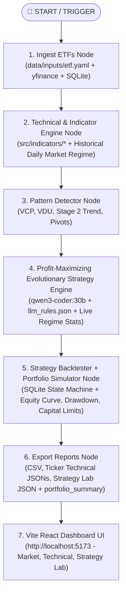

# Stock Analyzer AI - System Blueprint & Execution Architecture

> **Purpose**: This document serves as a comprehensive reference and execution blueprint for developers and AI agents operating on this repository. It documents the multi-agent architecture, TradingView Pine Script indicator parity (`RS.pine`), Market Regime health model, Profit-Maximizing Evolutionary Strategy Engine, and step-by-step compilation workflows.

---

## 1. Project Overview & Architecture

`stock-analyzer.ai` is a top-down market rotation model built using `agentgraph-compiler` (`forge` CLI), local LLM orchestration (`qwen3-coder:30b` via Ollama), and React Vite.

It focuses **exclusively on ETF categories** (*Breadth, Canaries, Defense, Leadership, Leveraged_Long, Leveraged_Short*), eliminating traditional single-stock fundamental noise. It performs deterministic technical analysis, Pine Script indicator parity calculations (`RS.pine`), high-performance SQLite strategy backtesting, objective Market Regime classification, autonomous evolutionary strategy optimization, and interactive technical charting.

### Centralized Logging

All system events, SQL execution logs, LLM candidate strategy hypotheses, parameter grid evaluations, backtest metrics, and promotion decisions are streamed centrally into:
- **`logs/stock_analyzer.log`**

### Quick Start Command

To run the complete data processing pipeline and launch the web UI in a single step:

```bash
uv run dashboard  # runs the full pipeline, including ETF ingestion which populates SQLite tables
```

*(See [runbook.md](file:///Users/chay/git/stock-analyzer.ai/runbook.md) for full CLI instructions).*

---

## 2. Market Regime & Health Score Model

The system objectively evaluates daily top-down market posture (`🟢 PRESS GAS`, `🟡 HALF SIZE`, `🔴 STEP ASIDE`) based on ETF health rotation rules:

### Health Score Rules (0 to 4)

- **Canaries Group** (`SPY`, `QQQ`, `IWM`, `SMH`, `SPMO`, `IGV`):
  - `+1`: `Close > EMA21`
  - `+1`: `Close > SMA50`
  - `+1`: `EMA21 > SMA50`
  - `+1`: `EMA8 > EMA21`
- **All Other Groups** (*Leadership, Breadth, Defense, Leveraged_Long, Leveraged_Short*):
  - `+1`: `Close > EMA21`
  - `+1`: `Close > SMA50`
  - `+1`: `RS_Daily% >= 0`
  - `+1`: `RS_Weekly% >= 0`

**Healthy ETF Threshold**: `Score >= 3`

### Regime Determination

- **🟢 PRESS GAS** (`PRESS_GAS`): Canaries $\ge 80\%$, Leadership $\ge 70\%$, Breadth $\ge 70\%$, Defense $\le 30\%$
- **🟡 HALF SIZE** (`HALF_SIZE`): Canaries $\ge 60\%$, Leadership $\ge 40\%$, Breadth $\ge 40\%$, Defense $\le 50\%$
- **🔴 STEP ASIDE** (`STEP_ASIDE`): Otherwise

### Confidence Score %

$$\text{Confidence} = 0.40 \times \text{Canaries\%} + 0.30 \times \text{Leadership\%} + 0.20 \times \text{Breadth\%} + 0.10 \times (100 - \text{Defense\%})$$

---

## 3. Pine Script & Indicator Parity (`src/indicators/`)

All technical indicators are modular Python functions under `src/indicators/`:

1. **Mansfield Relative Strength (`src/indicators/mansfield_rs.py`)**:
   - Implements exact TradingView [`RS.pine`](file:///Users/chay/git/stock-analyzer.ai/data/pine_indicators/RS.pine) parity:
     $$\text{MRS Index} = \left( \frac{\text{Close}_{\text{ETF}} / \text{Close}_{\text{SPY}}}{\text{SMA}_{52}(\text{Close}_{\text{ETF}} / \text{Close}_{\text{SPY}})} - 1 \right) \times 10$$
   - Supports 52-period daily (`mrs_daily_index`) and weekly (`mrs_weekly_index`) relative strength.
2. **Moving Averages (`src/indicators/moving_averages.py`)**:
   - `EMA 8`, `EMA 21`, `SMA 50`, `SMA 200`.
3. **RSI 14 (`src/indicators/rsi.py`)**:
   - Daily rolling RSI series (`calculate_rsi_series`).
4. **52-Week Offsets (`src/indicators/columns/`)**:
   - `pct_off_52wk_high.py` and `pct_off_52wk_low.py`.
5. **MarketSmith 1-99 RS Percentile Rating (`src/indicators/mansfield_rs.py`)**:
   - Weighted 4-quarter performance vs SPY benchmark.

---

## 4. Multi-Agent DAG Architecture



---

## 5. LLM Rules & Context (`data/inputs/llm_rules.json`)

**Single source of truth** for all context and constraints sent to the local LLM. Edit this file to tune optimizer behavior — no Python changes required.

| Section | Type | Purpose |
| :--- | :--- | :--- |
| `entry_guidance.preferred_baseline` | Static | Preferred entry filter conditions injected into every LLM prompt |
| `entry_guidance.avoid_conditions` | Static | Conditions the LLM should not use (e.g., `PRESS_GAS` alone which rarely fires) |
| `exit_rules.always_require` | Static | **Hard SQL exit** always injected into every strategy before backtesting — non-negotiable |
| `universe_hints` | Static | Per-universe strategic context loaded dynamically — ETF tickers injected at runtime from SQLite |
| `zero_trade_recovery.message` | Static | Recovery message appended to prompt when all hypotheses produce 0 trades |
| `regime_context` | **Dynamic** | Computed live from all available SQLite data — never hardcoded |

---

## 6. Profit-Maximizing Evolutionary Strategy Engine (`src/graphs/nodes/optimize_strategies.py`)

The strategy optimizer operates as an autonomous parameter-tuning and profit-maximization loop:

- **Local LLM Model**: `qwen3-coder:30b` via Ollama (`http://127.0.0.1:11434/api/chat`).
- **LLM Context Source**: All prompt context sourced exclusively from `data/inputs/llm_rules.json` (static) + live SQLite regime distribution (dynamic — computed over ALL available historical data, not a fixed lookback window).
- **7 Target Universes**: `Leveraged_Long`, `Leveraged_Short`, `Leadership`, `Breadth`, `Defense`, `Canaries`, `All ETFs`.
- **Parameter Grid Sweeps**: 12+ parameter combinations per hypothesis (Stop Loss: 3%, 5%, 7%, 8%; Multi-step Profit Trims: 15%/30%, 20%/35%/50%, 25%/50%).
- **Hard Exit Injection**: The mandatory exit rule from `llm_rules.json` (`exit_rules.always_require`) is always AND-injected into every strategy before backtesting — the LLM cannot omit it.
- **0-Trade Recovery**: If all hypotheses for a universe produce 0 trades, the `zero_trade_recovery.message` from `llm_rules.json` is appended to the retry prompt.
- **Objective Function**: Promotes the single **Max Net Dollar Profit ($)** Champion per universe (Trades $\ge 5$, Win Rate $\ge 50\%$, Profit Factor $\ge 1.3$).
- **Auto-Persistence**: Saves promoted champions directly into `data/inputs/strategies.json`.

---

## 7. Portfolio Simulation Engine (`src/strategy/portfolio_simulator.py`)

A realistic account-level simulation layer on top of the per-trade backtest engine. Configured entirely via `configs/config.yaml` under `portfolio_simulation:`.

```yaml
portfolio_simulation:
  starting_capital: 100000       # Starting account size in dollars
  max_concurrent_positions: 5    # Max open trades at any one time
  position_size_pct: 0.20        # 20% of current equity per trade (dynamic sizing)
  cash_reserve_pct: 0.10         # Always keep 10% cash buffer
  commission_per_trade: 0.0      # $ commission per trade (0 = no friction)
```

**How it works:** After `SQLStrategyEngine` generates per-trade results, `PortfolioSimulator` replays all trades chronologically through a shared capital pool:

| Metric | Description |
| :--- | :--- |
| `ending_capital` | Final account value in dollars |
| `total_return_pct` | `(ending − starting) / starting × 100` |
| `max_drawdown_pct` | Worst peak-to-trough % equity drop |
| `trades_taken` | Trades actually entered (capital/position limit permitted) |
| `trades_skipped` | Signals missed due to capital or max-position cap |
| `capital_utilization_pct` | % of trading days with at least one open position |
| `equity_curve` | `[{date, equity}, ...]` — daily account value for charting |

Results are output to `data/outputs/strategy_lab.json` under the `portfolio_summary` key, one entry per strategy.

---

## 8. Preset Strategy Lab Engine (`data/inputs/strategies.json`)

Strategies are defined in JSON format and executed natively in SQLite:

- **Preset File**: `data/inputs/strategies.json`
- **Supported Indicators**: `ema_8`, `ema_21`, `sma_50`, `sma_200`, `rsi_14`, `mrs_daily_index`, `mrs_weekly_index`, `close`, `r.regime_code`.
- **Zero Default Fallback**: Risk management stop loss is strictly opt-in (`"stop_loss_pct": 0.05`).
- **On-Demand Backtesting**: Executes ~1-second vector state machine per ticker with execution logs sorted by entry date descending.

---

## 9. Summary of Database & Files

- **Strategy Inputs**: `data/inputs/strategies.json` (defines preset entry/exit strategies).
- **LLM Rules**: `data/inputs/llm_rules.json` (single source of truth for all LLM context — no ETF tickers hardcoded).
- **Portfolio Config**: `configs/config.yaml` → `portfolio_simulation` block (starting capital, position sizing, max concurrent positions).
- **SQLite DB**: `data/db/etfs.db` (contains `ohlcv`, `etf_metadata` with `etf_group`, `etf_daily_indicators`, and `daily_market_regime` tables).
- **Log File**: `logs/stock_analyzer.log` (centralized application and strategy optimizer logging).
- **Outputs**: `data/outputs/`:
  - `etfs_tracker.json` — ETF scan with RS, indicators, and regime data
  - `market_regime.json` — current market regime classification
  - `strategy_lab.json` — strategy registry, backtest results, and `portfolio_summary` (equity curve, drawdown, account value)
  - `tickers/technical/<SYMBOL>.json` — per-ticker OHLCV + indicator history
  - `latest_scan.csv` — tabular scan export
- **Dashboard App**: `dashboard/` (Vite React app rendering Market, Technical Analysis, and Strategy Lab).

