# Stock Analyzer Dashboard

The frontend visualization layer for the Stock Analyzer system. It is built using **React**, **TypeScript**, and **Vite** to provide a lightning-fast, premium user experience.

---

## Dashboard Architecture Flowchart

The following diagram illustrates how user actions trigger client-side React rendering, how the data flows from local files through the Vite dev server proxy middleware, and how components are organized:

```mermaid
graph TD
    subgraph Client ["1. User Interaction (React UI)"]
        TableClick["Click Ticker in Table"]
        TabSwitch["Switch Tabs<br>(Market, Theme Tracker, Fund, Tech)"]
        ChartToggle["Toggle Technical Indicators<br>(SMA, EMA, VCP)"]
    end

    subgraph ReactComp ["2. Component Tree Layout"]
        MainDashboard["App.tsx / Dashboard Layout"]
        TickerTable["TickerTable Component<br>(Filter, Sort & Paginate Tickers)"]
        ThemeTracker["ThemeTracker PageComponent<br>(Group by Sector & Performance)"]
        DetailView["TickerDetail Panel<br>(Selected Stock Context)"]
        StockChart["StockChart Component<br>(Lightweight Charts Canvas)"]
        ReportEmbed["FundamentalReport Component<br>(Dynamic iframe Embed)"]
        FinancialsTable["FinancialsTable Component<br>(Tabular Growth Trends)"]
    end

    subgraph Network ["3. Client Data Fetching & Server Proxy"]
        AxiosFetch["Async Fetch / REST Requests"]
        ViteProxy["Vite Dev Server Middleware<br>(vite.config.ts)"]
    end

    subgraph Storage ["4. Backend Outputs (Local Disk)"]
        ScanCSV["latest_scan.csv<br>(Scores & Ticker Meta)"]
        ThemeJSON["theme_tracker.json<br>(Compiled sector performance)"]
        TechJSON["tickers/technical/[SYMBOL].json<br>(3y Historical Prices)"]
        FundHTML["tickers/fundamental/[SYMBOL]_analysis.html<br>(AI Card)"]
    end

    %% Component Nesting & Relations
    MainDashboard --> TickerTable
    MainDashboard --> ThemeTracker
    MainDashboard --> DetailView
    DetailView --> StockChart
    DetailView --> ReportEmbed
    DetailView --> FinancialsTable

    %% UI Events & Fetching
    TableClick -->|Updates Selected Symbol state| DetailView
    TickerTable -->|Queries list| AxiosFetch
    ThemeTracker -->|Queries aggregated data| AxiosFetch
    DetailView -->|Queries symbol details| AxiosFetch
    
    %% Proxy resolution
    AxiosFetch -->|Requests /default_scan.csv| ViteProxy
    AxiosFetch -->|Requests /theme_tracker.json| ViteProxy
    AxiosFetch -->|Requests /technical-data/*.json| ViteProxy
    AxiosFetch -->|Requests /fundamental-analysis/*.html| ViteProxy

    %% Storage reads
    ViteProxy -->|Serves file from disk| ScanCSV
    ViteProxy -->|Serves file from disk| ThemeJSON
    ViteProxy -->|Serves file from disk| TechJSON
    ViteProxy -->|Serves file from disk| FundHTML

    %% Styling
    classDef client fill:#f8fafc,stroke:#cbd5e1,stroke-width:1px,color:#0f172a
    classDef react fill:#eff6ff,stroke:#bfdbfe,stroke-width:1px,color:#1e40af
    classDef net fill:#faf5ff,stroke:#e9d5ff,stroke-width:1px,color:#6b21a8
    classDef store fill:#f0fdf4,stroke:#bbf7d0,stroke-width:1px,color:#166534

    class TableClick,TabSwitch,ChartToggle client
    class MainDashboard,TickerTable,ThemeTracker,DetailView,StockChart,ReportEmbed,FinancialsTable react
    class AxiosFetch,ViteProxy net
    class ScanCSV,ThemeJSON,TechJSON,FundHTML store
```



---

## Key Features

1. **Theme Tracker**: Groups all watchlisted stocks at the **Sector** level inside high-performance widgets. Displays returns across 5D, 10D, 1M, and 3M windows alongside Relative Strength rankings and daily/weekly RS percentages.
2. **VCP Contraction Visualization**: Automatically detects and plots Volatility Contraction Patterns (VCP) with contraction counts, depth, and volume dry-ups.
3. **Interactive Stock Charts**: Renders 3-year interactive candlestick charts containing SMA 50/200, EMA 8/21/65, and Volume.
4. **Fundamental Scorecard Integrations**: Displays the 9-Factor scorecard verdicts, economic moats, and themes.
5. **Interactive Financial Tables**: Breaks down historical quarterly Diluted EPS, Net Income, and Revenue growth trends.

---

## Local Data Integration (Vite Proxy Middleware)

The dashboard is designed to load data **locally and instantly** from the directories generated by the Python backend. In [vite.config.ts](file:///Users/chay/git/stock-analyzer/dashboard/vite.config.ts), we use a custom server middleware that acts as a proxy:

* `/default_scan.csv` $\rightarrow$ Serves `data/outputs/latest_scan.csv`
* `/theme_tracker.json` $\rightarrow$ Serves `data/outputs/theme_tracker.json` (compiled dataset for Theme Tracker widgets)
* `/fundamental-analysis/<SYMBOL>_analysis.html` $\rightarrow$ Serves `data/outputs/tickers/fundamental/<SYMBOL>_analysis.html` (embedded dynamically in the UI)
* `/technical-data/<SYMBOL>.json` $\rightarrow$ Serves `data/outputs/tickers/technical/<SYMBOL>.json` (loads on-demand when clicking a stock)

This architecture eliminates the need for a persistent database, serving static files directly from disk while keeping the dashboard fast.

---

## Launch Instructions

To launch the dashboard, make sure you have **Node.js** installed, then run:

```bash
# Navigate to the dashboard directory
cd dashboard

# Install dependencies (only required on first setup)
npm install

# Start the development server
npm run dev
```

The application will start running on **[http://localhost:5173/](http://localhost:5173/)**.
