# Workflow Flowchart

This flowchart represents the compiled execution DAG of the agent.

```mermaid
flowchart TD
    ingest_etfs["ingest_etfs\n(Loads ETF tickers from\ndata/inputs/etf.yaml and fetches\n3-year OHLCV data into SQLite.)"]
    calculate_indicators["calculate_indicators\n(Calculates EMA 8/21/50/200, ATR14, RSI14,\n52-period Mansfield RS vs SPY/QQQ,\nand daily historical Market Regime.)"]
    detect_patterns["detect_patterns\n(Detects Volatility Contraction Patterns\n(VCP), Volume Dry-Up (VDU), Stage 2\ntrend, and pivot levels.)"]
    optimize_strategies["optimize_strategies\n(Loads rules from data/inputs/llm_rules.json,\ncomputes live regime stats from SQLite,\nruns multi-round profit-max parameter sweep)"]
    run_backtests["run_backtests\n(SQLite state machine + PortfolioSimulator:\nequity curve, drawdown, capital limits,\nper-strategy account value from config.yaml)"]
    export_reports["export_reports\n(Generates output summary CSV and JSON\ntechnical dashboard artifacts.)"]
    ai_analysis["ai_analysis\n(Optional executive synthesis using\nlocal LLM model.)"]
    START([START])
    START --> ingest_etfs
    ingest_etfs --> calculate_indicators
    calculate_indicators --> detect_patterns
    detect_patterns --> optimize_strategies
    optimize_strategies --> run_backtests
    run_backtests --> export_reports
    export_reports --> ai_analysis
    END([END])
    ai_analysis --> END

    %% Styling Rules
    style START fill:#2ecc71,stroke:#fff,stroke-width:2px,color:#fff
    style END fill:#e74c3c,stroke:#fff,stroke-width:2px,color:#fff
    classDef nodeStyle fill:#2980b9,stroke:#fff,stroke-width:2px,color:#fff;
    class detect_patterns,export_reports,ingest_etfs,run_backtests,calculate_indicators nodeStyle;
    classDef cognitiveStyle fill:#8e44ad,stroke:#fff,stroke-width:2px,color:#fff;
    class ai_analysis,optimize_strategies cognitiveStyle;
```

## Node Directory

| Node | Function | Chains | Description |
| :--- | :--- | :--- | :--- |
| **ingest_etfs** | `ingest_etfs` | `None` | Loads ETF tickers from `data/inputs/etf.yaml` and fetches 3-year daily OHLCV data into SQLite database (`data/db/etfs.db`). |
| **calculate_indicators** | `calculate_indicators` | `None` | Calculates EMA 8/21/50/200, ATR14, RSI14, 52-period Mansfield RS vs SPY, and daily historical Market Regime into SQLite. |
| **detect_patterns** | `detect_patterns` | `None` | Detects Volatility Contraction Patterns (VCP), Volume Dry-Up (VDU), Stage 2 trend, and pivot levels. |
| **optimize_strategies** | `optimize_strategies` | `qwen3-coder:30b` | Autonomous Profit-Maximizing LLM optimizer. Loads all context from `data/inputs/llm_rules.json` (static rules, exit injection, universe hints, 0-trade recovery) merged with live regime distribution from all available SQLite data. Runs multi-round parameter grid sweeps and promotes the max Net Profit ($) champion per universe into `strategies.json`. |
| **run_backtests** | `run_backtests` | `None` | Executes `SQLStrategyEngine` on all strategies in `strategies.json`, then runs `PortfolioSimulator` (finite capital, max concurrent positions, dynamic position sizing from `config.yaml`). Produces per-trade metrics + equity curve, drawdown, account value, and trades skipped. |
| **export_reports** | `export_reports` | `None` | Generates output CSVs, Market Regime JSON, Strategy Lab JSON (including `portfolio_summary` with equity curve + account metrics per strategy), and Ticker Technical JSONs under `data/outputs/`. |
| **ai_analysis** | `ai_analysis` | `market_summary_chain` | (Optional) Synthesizes executive market summary using local LLM model. |
