# StockWave Execution & Evolutionary Research Flowchart

This document details both the **High-Level LangGraph DAG Execution Flow** and the **Sub-System Mechanics of the StockWave Evolutionary Research Engine**.

---

## 1. Complete System Flowchart (Detailed Sub-Systems)

```mermaid
flowchart TD
    START([🚀 START / TRIGGER]) --> IngestNode

    subgraph NODE1 ["1. Ingest ETFs Node"]
        IngestNode["ingest_etfs"] -->|Reads| ETF_Yaml["data/inputs/etf.yaml"]
        ETF_Yaml -->|Fetch 3Y OHLCV| YFinance["yfinance API"]
        YFinance -->|Insert/Upsert| DB_OHLCV[("SQLite: ohlcv & etf_metadata")]
    end

    DB_OHLCV --> TechNode

    subgraph NODE2 ["2. Technical & Indicator Engine Node"]
        TechNode["calculate_indicators"] -->|Compute 19 Technical Indicators| Indicators["EMA 8/13/21/50/65/200, ATR14, ATR14 %,<br>Vol MA20 Ratio, 20D Return %, RSI14,<br>Mansfield RS Daily & Weekly (vs SPY),<br>MarketSmith 1-99 RS Percentile Rating"]
        Indicators -->|Compute| DailyRegime["Daily Market Regime Classification<br>(PRESS_GAS, HALF_SIZE, STEP_ASIDE<br>+ Canary Health %)"]
        DailyRegime -->|Store| DB_Indicators[("SQLite: etf_daily_indicators<br>& daily_market_regime")]
    end

    DB_Indicators --> PatternNode

    subgraph NODE3 ["3. Pattern Detector Node"]
        PatternNode["detect_patterns"] -->|Scan| Patterns["VCP (Volatility Contraction),<br>VDU (Volume Dry-Up),<br>Stage 2 Uptrend, Pivot Levels"]
    end

    PatternNode --> EvolutionaryNode

    subgraph NODE4 ["4. StockWave Declarative Genetic Research Engine Node"]
        EvolutionaryNode["optimize_strategies"] -->|Load Master Specification| YAML_Rules["data/inputs/backtest_rules.yaml<br>(Numeric Ranges, Trend Series, Safety Rails)"]
        YAML_Rules -->|Dynamic Threshold Parsing| YAML_Loader["YAMLBacktestRulesLoader<br>(Parses Min, Max, Step Arrays at Runtime)"]
        YAML_Loader -->|Exhaustive Combination Sweep| GridGen["Exhaustive Permutation Engine<br>(Entry Rules: Strict AND Confluence<br>Exit Rules: Failsafe OR Protection)"]
        
        GridGen -->|Compile| SQLCompiler["StrategyCompiler<br>(Compiles Rule DNA to executable SQL)"]
        
        SQLCompiler -->|Execute Zero-Lookahead State Machine| SQLSim["SQLStrategyEngine<br>(Evaluates boolean conditions on SQLite,<br>Supports start_date/end_date train/test split)"]
        SQLSim -->|Log Experiments & Trades| DB_Research[("SQLite Research DB:<br>research_strategies,<br>research_experiments,<br>research_experiment_trades,<br>research_mutation_history")]

        DB_Research -->|Aggregate Stats| Aggregator["EvidenceAggregator<br>(Calculates Global & Regime-Grouped Stats:<br>PRESS_GAS vs HALF_SIZE vs STEP_ASIDE)"]

        SQLSim -->|Top-K Champion Pruning| ChampionFile["data/inputs/strategies.json<br>(Keeps strictly 1 champion per universe)"]
    end


    ChampionFile --> BacktestNode

    subgraph NODE5 ["5. Strategy Backtester & Portfolio Simulator Node"]
        BacktestNode["run_backtests"] -->|Load Champions| SQLStrategyConfig["SQLStrategyConfig"]
        SQLStrategyConfig -->|Execute Signal Simulation| EngineRuns["SQLStrategyEngine.run_universe_backtest()"]
        EngineRuns -->|Flat Trade Stream| PortSim["PortfolioSimulator<br>(Finite Capital, Concurrent Position Limits,<br>Dynamic Sizing, Cash Reserve)"]
        PortSim -->|Compute Account Metrics| PortResults["Ending Capital, Total Return %,<br>Max Drawdown %, Equity Curve, Trades Taken/Skipped"]
    end

    PortResults --> ExportNode

    subgraph NODE6 ["6. Export Reports Node"]
        ExportNode["export_reports"] -->|Export Scan CSV| CSV_Out["data/outputs/latest_scan.csv"]
        ExportNode -->|Export Theme Tracker| ETF_JSON["data/outputs/etfs_tracker.json"]
        ExportNode -->|Export Regime Metrics| Regime_JSON["data/outputs/market_regime.json"]
        ExportNode -->|Export Technical Series| Tech_JSON["data/outputs/tickers/technical/<SYMBOL>.json"]
        ExportNode -->|Export Strategy Registry| Lab_JSON["data/outputs/strategy_lab.json<br>(Contains backtest_results, portfolio_summary,<br>and empirical indicator_evidence)"]
    end

    Lab_JSON --> DashboardUI["7. Vite React Dashboard UI<br>(http://localhost:5173 - Market, Technical, Strategy Lab)"]
    DashboardUI --> END([🔴 END / COMPLETE])

    %% Styling
    style START fill:#2ecc71,stroke:#fff,stroke-width:2px,color:#fff
    style END fill:#e74c3c,stroke:#fff,stroke-width:2px,color:#fff
    classDef nodeStyle fill:#2980b9,stroke:#fff,stroke-width:2px,color:#fff;
    class detect_patterns,export_reports,ingest_etfs,run_backtests,calculate_indicators nodeStyle;
    classDef cognitiveStyle fill:#8e44ad,stroke:#fff,stroke-width:2px,color:#fff;
    class optimize_strategies cognitiveStyle;
```

---

## 2. Detailed Node Directory

| Node | Function | Chains / LLM | Description | Inputs | Primary Outputs |
| :--- | :--- | :--- | :--- | :--- | :--- |
| **`ingest_etfs`** | `ingest_etfs` | `None` | Loads target ETF tickers by group from `data/inputs/etf.yaml`, fetches historical daily OHLCV from `yfinance`, and populates `ohlcv` and `etf_metadata` tables. | `data/inputs/etf.yaml` | `data/db/etfs.db` (`ohlcv`, `etf_metadata`) |
| **`calculate_indicators`** | `calculate_indicators` | `None` | Computes EMA 8/21/50/200, RSI 14, Volume 20 MA, 52-week offsets, Mansfield RS (Daily & Weekly vs SPY), MarketSmith 1-99 RS Percentile Rating, and historical daily Market Regime into SQLite. | `data/db/etfs.db` (`ohlcv`) | `data/db/etfs.db` (`etf_daily_indicators`, `daily_market_regime`) |
| **`detect_patterns`** | `detect_patterns` | `None` | Scans for technical chart patterns including Volatility Contraction Patterns (VCP), Volume Dry-Up (VDU), Stage 2 Uptrend, and Pivot Levels across all tickers. | `data/db/etfs.db` | State object (`patterns`) |
| **`optimize_strategies`** | `optimize_strategies` | `None` (Declarative) | **StockWave Declarative Genetic Engine** (`src/research/`). Reads master specification from `backtest_rules.yaml`, dynamically computes numeric ranges via `YAMLBacktestRulesLoader`, exhaustively evaluates entry (`AND`) and exit (`OR`) indicator confluences across SQLite, and promotes top champions per universe. | `data/inputs/backtest_rules.yaml`, SQLite DB | `data/inputs/strategies.json`, SQLite DB (`research_strategies`, `research_experiments`, `research_experiment_trades`) |
| **`run_backtests`** | `run_backtests` | `None` | Executes `SQLStrategyEngine` on all saved strategies in `strategies.json`, then runs `PortfolioSimulator` (simulates finite capital pool, concurrent position caps, dynamic position sizing, and equity curves from `config.yaml`). | `data/inputs/strategies.json`, `configs/config.yaml` | State object (`all_strategy_results`, `portfolio_simulation`) |
| **`export_reports`** | `export_reports` | `None` | Generates tabular scan CSV, Market Regime JSON, Ticker Technical JSONs, and `strategy_lab.json` (including `portfolio_summary` equity curves and `indicator_evidence` rankings from SQLite). | State object | `data/outputs/*` (`latest_scan.csv`, `etfs_tracker.json`, `market_regime.json`, `strategy_lab.json`) |

